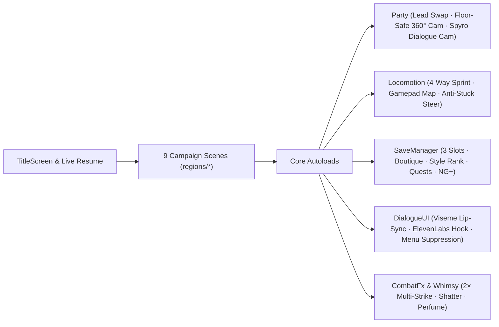

<div align="center">

# ✦ OZ: THE ROAD HOME ✦
### *A Dark-Fairytale 3D Action-Adventure RPG in Godot 4.8 — Faithful to L. Frank Baum's 1900 Novel*

[](https://godotengine.org/)
[](#baum-1900-public-domain-canon)
[](#complete-9-chapter-campaign-map)
[](#the-5-character-playable-party--superpowers)
[](#controls-keyboard-mouse--ps5--xbox--nintendo-switch)
[](https://github.com/realdyl/obsidian-oz)

*The grey farmhouse falls. The Silver Shoes choose Dorothy. Oz is a gilded wonderland ruled by a humbug — and the only road home is walked together.*

</div>

---

## ✨ What Is *Oz: The Road Home*?

**Oz: The Road Home** is a stylized third-person 3D action-adventure RPG built in **Godot 4.8 (Forward+ / Metal)** blending the **gothic dark-fairytale atmosphere** of *Alice: Madness Returns* with **seamless 5-character party swapping**, **cinematic shot/reverse-shot dialogue**, **phoneme/viseme lip-sync**, and **100% public-domain fidelity to L. Frank Baum's 1900 novel *The Wonderful Wizard of Oz***.

- **Full 24-Chapter Adaptation across 9 Playable Levels:** From monochrome grey Kansas through Munchkinland, the Kalidah Wilds, the Deadly Poppy Field, Winkie Iron Keep, the Emerald City, Dainty China Country, Glinda's Quadling Court, and back home to Kansas.
- **5 Playable Characters (`Tab` / `1–5` / D-Pad):** Seamlessly lead as **Dorothy Gale**, **The Scarecrow**, **The Tin Woodman**, **The Cowardly Lion**, or **Toto** — the entire bonded party dynamically follows your active Lead and fights alongside you.
- **Distinct Combat (`F`) & Extra Superpowers (`Z` / `X` / `C`):** Zero duplicate abilities between primary combat and extra kits, plus **2× Multi-Whimsy Strike** bonuses, **Style Rank (`D` → `★ SOVEREIGN`)**, and **Rapture Mode (`H`)**.
- **2026 Retail Presentation:** Gothic-filigree Title Screen with live session resume, Open-Book **Oz Grimoire (`J`)**, **The Tailor of Vices Boutique (`B`)** with a live 3D rotating turntable and layered outfits/footwear/hosiery, **Spyro-style zero-occlusion dialogue camera**, real-time **viseme mouth sync** + **ElevenLabs voice-clip auto-loader**, and **9 bespoke widescreen loading screens**.
- **Universal Input:** Native **Keyboard & Mouse**, **PlayStation DualSense**, **Xbox Series X|S**, and **Nintendo Switch Pro** support (plus an **OpenXR VR Diorama** roadmap for Meta Quest 3 & Apple Vision Pro).

---

## 🗺️ Complete 9-Chapter Campaign Map

| Act | Chapter & Region | Baum (1900) | Scene Path | Signature Mechanics & Landmarks |
| --- | --- | --- | --- | --- |
| **I** | **Kansas — The Gale Farm** | Ch. I | `regions/kansas/farmyard.tscn` | Monochrome noir prairie, wicker basket & Toto rescue, enterable Farmhouse/Barn/Chicken Coop, 2-way swinging gate, cyclone lift. |
| **II** | **Munchkinland — Crash Square** | Ch. II–VI | `regions/munchkinland/landing_square.tscn` | Interactive Locasta counsel, Silver Shoes claim, Rogue Munchkin swarms, unlock Scarecrow, Lion & Tin Man, Lollipop Guild Marshal. |
| **IIIa** | **The Kalidah Wilds & Great Chasms** | Ch. VII | `regions/wilds/kalidah_wilds.tscn` | First Great Chasm Lion Courage Leap, 4 sculpted **Kalidah Shadow-Beasts** (bear-tiger chimeras), Tin Man fells Ancient Pine bridge. |
| **IIIb** | **The Deadly Poppy Field** | Ch. VIII–IX | `regions/poppy/poppy_road.tscn` | 2,400+ GPU-instanced swaying scarlet poppies, sleep meter on flesh vs. straw/tin immunity, Crystal Wind-Fountain & Mice Cart rescue. |
| **IV** | **Winkie Country — Iron Keep** | Ch. XII–XIII | `regions/winkie/west_castle.tscn` | Progressive 3-stage siege, **Winged Monkeys**, armored Marshals, chalk-pale one-eyed **Wicked Witch of the West** & Cistern water melt. |
| **V** | **The Emerald City — Wizard's Palace** | Ch. X–XVII | `regions/emerald_city/wizard_tower.tscn` | Sealed Emerald Double Doors, `[G]` Green Spectacles illusion seals, **Tailor of Vices**, moored **16-gore Victorian Silk Balloon**, Curtain Reveal. |
| **VIa** | **Fighting Trees & Dainty China Country** | Ch. XVIII–XXI | `regions/south/china_country.tscn` | 4 Fighting Oaks, gleaming white-and-cobalt **Delft Porcelain Village**, interactive **China Princess**, **Giant Forest Spider** boss. |
| **VIb** | **Quadling Country — Glinda's Court** | Ch. XXII–XXIII | `regions/quadling/glinda_court.tscn` | Alabaster Temple Rotunda, Reflecting Pools, interactive party farewell, **3× `C` Silver Heel-Click** ceremony on the Road Home altar. |
| **VII** | **Kansas — Homecoming** | Ch. XXIV | `regions/kansas/homecoming.tscn` | Monochrome prairie return, distant drifting Omaha Silk Balloon, Aunt Em, Uncle Henry & Toto reunion, unlocks **`★ THE VELVET ROAD` (NG+)**. |

---

## ⚔️ The 5-Character Playable Party & Superpowers

Every character's signature combat move (`F`) is strictly distinct from their 4 selectable `Z` / `X` / `C` extra superpowers:

| Character | Key | Primary Combat (`F`) | Extra Superpowers (`Z`/`X` cycle · `C` cast) |
| --- | --- | --- | --- |
| **Dorothy Gale** | `1` | **3-Hit Silver-Shoe Kick** | **Lace Whip** *(Boutique)* · **Silk Bindings** · **Hypnotic Perfume** *(2× urn/whimsy buff)* · **Gilded Chain** · **Silver Heel-Click** |
| **The Scarecrow** | `2` | **Murder of Crows (`CAW`)** | **Straw Decoy** · **Lantern Spark** · **Harvest Gust** *(multi-whimsy sweep)* · **Patchwork Tether** |
| **The Tin Woodman** | `3` | **2-Stage Steel Axe Cleave** | **Oil-Slick Slide** · **Steam Overdrive** · **Heart-Chime Ward** *(+1 HP)* · **Magnetic Gear-Pull** |
| **The Cowardly Lion** | `4` | **Royal Roar Shockwave** | **Apex Pounce** · **Mane-Flare Courage** · **Earthshaker Slam** · **Velvet Stalk** |
| **Toto** | `5` | **Sonic Terrier Bark** | **Golden Scent Trail** · **Ankle-Nip Trip** · **Prairie Dig** · **Curtain-Pull Dash** |

---

## 🎮 Controls (Keyboard/Mouse · PS5 · Xbox · Nintendo Switch)

| Action | Keyboard / Mouse | PlayStation DualSense | Xbox Series X\|S | Nintendo Switch Pro |
| --- | --- | --- | --- | --- |
| **Move (360°)** | `Arrows` / `WASD` | Left Stick | Left Stick | Left Stick |
| **Sprint** | Double-tap any direction (`↑↑`/`↓↓`/`←←`/`→→`) or `Shift` | `L3` (Left Stick Click) | `L3` (Left Stick Click) | `L3` (Left Stick Click) |
| **360° Camera** | Mouse · `RMB + WASD` · Scroll Zoom | Right Stick | Right Stick | Right Stick |
| **Jump / Silver Blink** | `Space` | `✕` (Cross) | `A` | `B` |
| **Primary Combat Kit** | `F` | `□` (Square) | `X` | `Y` |
| **Interact / Talk / Doors** | `E` | `○` (Circle) | `B` | `A` |
| **Cast Extra Superpower** | `C` | `△` (Triangle) / `R2` | `Y` / `RT` | `X` / `ZR` |
| **Cycle Superpowers** | `Z` / `X` | `L1` / `R1` | `LB` / `RB` | `L` / `R` |
| **Swap Party Lead** | `Tab` / `1–5` | D-Pad `◀` / `▶` | D-Pad `◀` / `▶` | D-Pad `◀` / `▶` |
| **Boutique / Grimoire** | `B` / `J` | D-Pad `▲` / `▼` | D-Pad `▲` / `▼` | D-Pad `▲` / `▼` |
| **Green Spectacles / Pause** | `G` / `Esc` | Create / Options | View / Menu | `-` / `+` |

---

## 🚀 Quickstart & Running Locally

1. Install **Godot 4.8+** ([godotengine.org](https://godotengine.org/)).
2. Clone the repository and open `oz/project.godot` in Godot 4.8, then press **F5 (Play)**.
3. **Optional ElevenLabs Voice Clones:** Drop `.ogg`, `.mp3`, or `.wav` dialogue clips into `res://assets/audio/voices/<speaker_slug>/<md5_10>.ogg` — `DialogueUI` automatically detects and plays them with live viseme lip-sync before falling back to OS TTS.

---

## 🧠 Architecture & AI-Agent Quick Reference



### Autoload Singletons (`project.godot`)
| Singleton | Script | Responsibility |
| --- | --- | --- |
| `Party` | `systems/party_manager.gd` | 5-character registration, Lead cycling, floor-clamped 360° camera, zero-occlusion Spyro dialogue camera. |
| `Locomotion` | `systems/locomotion_util.gd` | Omnidirectional double-tap sprint, unified PS5/Xbox/Switch InputMap bindings, 3-whisker obstacle steering, stall recovery. |
| `SaveManager` | `systems/save_manager.gd` | 3 JSON save slots, live Title-Screen resume snapshot, Boutique catalog, footwear/hosiery layering, Style Rank, Vile Requests, NG+. |
| `DialogueUI` | `systems/dialogue_ui.gd` | Typewriter storybook card, portrait medallions, 60 FPS phoneme/viseme mouth driver, ElevenLabs audio player, strict menu/title suppression. |
| `LevelTransition` | `systems/level_transition.gd` | Animated brass hourglass + 9 regional widescreen painted backdrops (`assets/art/scenes/*.jpg`). |
| `Whimsy` | `systems/whimsy.gd` | Regional interactive whimsies, 2× Multi-Whimsy Strike bonus, Perfume 2× synergy, Road's Blessing boons. |
| `CombatFx` | `systems/combat_fx.gd` | Whip S-wave lash, porcelain shattering, perfume mist vortex, heel-click starburst, crow storms, roar shockwaves, witch melt. |
| `AudioFx` | `systems/audio_manager.gd` | Procedural & sampled SFX bus (`kick`, `whip`, `ui_hover`, `ui_click`, `page_turn`, `buy`). |

### Mandatory Headless QA Verification (All 5 Suites Must Exit `0`)

```bash
GODOT=/Applications/Godot.app/Contents/MacOS/Godot
$GODOT --headless --path . -s res://tools/smoke_check.gd && \
$GODOT --headless --path . -s res://tools/kansas_sim.gd && \
$GODOT --headless --path . -s res://tools/play_sim.gd && \
$GODOT --headless --path . -s res://tools/act34_sim.gd && \
$GODOT --headless --path . -s res://tools/retail_p3_sim.gd
```

### Baum 1900 Public Domain Canon
- **Canonical:** Silver Shoes (not ruby slippers), chalk-pale one-eyed Wicked Witch of the West (not green skin), Locasta (Good Witch of the North), Glinda (Good Witch of the South), Kalidahs, Dainty China Country, Giant Forest Spider, Omaha silk hot-air balloon.
- **Companion Design Bible:** Full lore, phase master plans (`P1.5 → P12.5`), art prompt libraries, and production logs live in **[realdyl/obsidian-oz](https://github.com/realdyl/obsidian-oz)**.
- **Developer & Agent Rules:** See [`AGENTS.md`](./AGENTS.md) and [`README_DEV.md`](./README_DEV.md).
